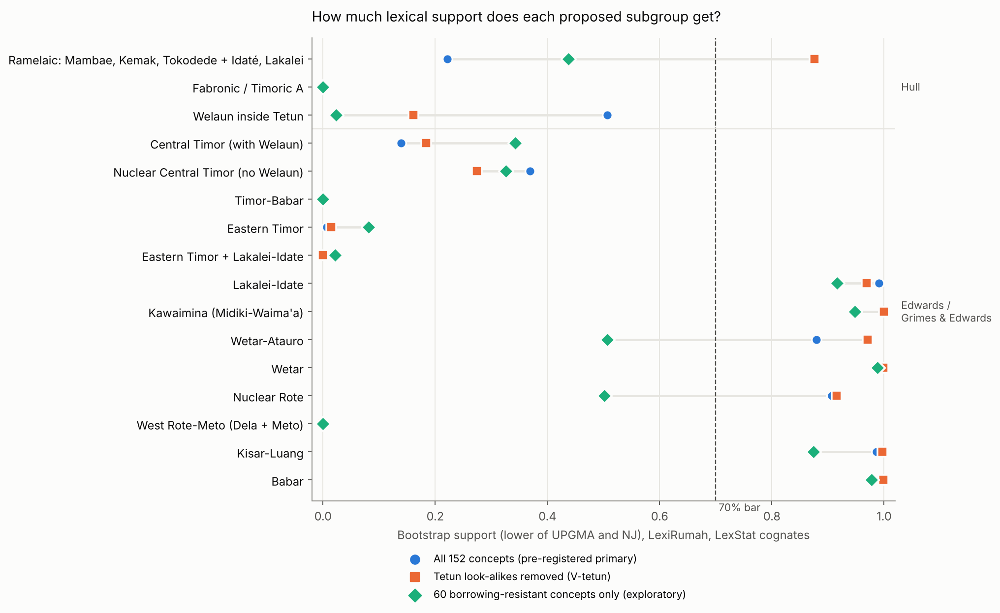
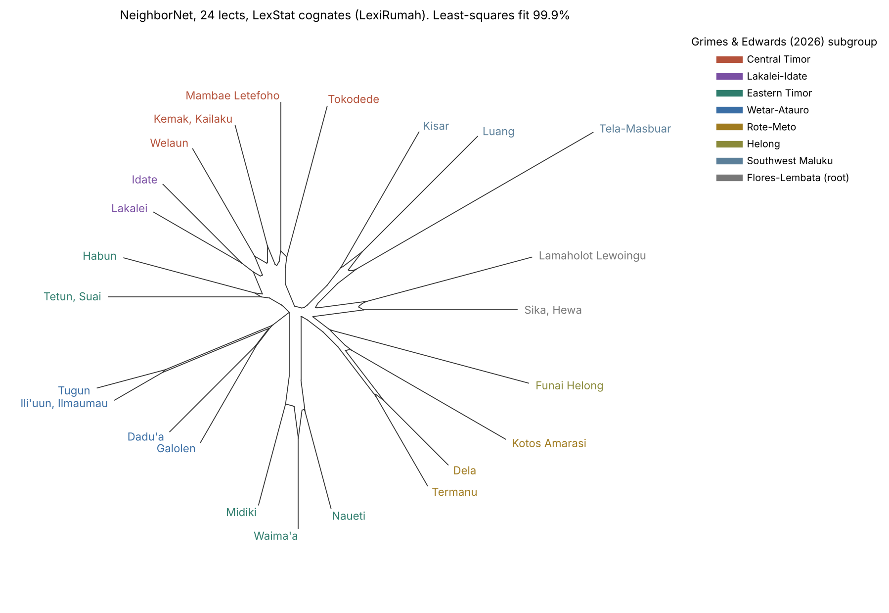
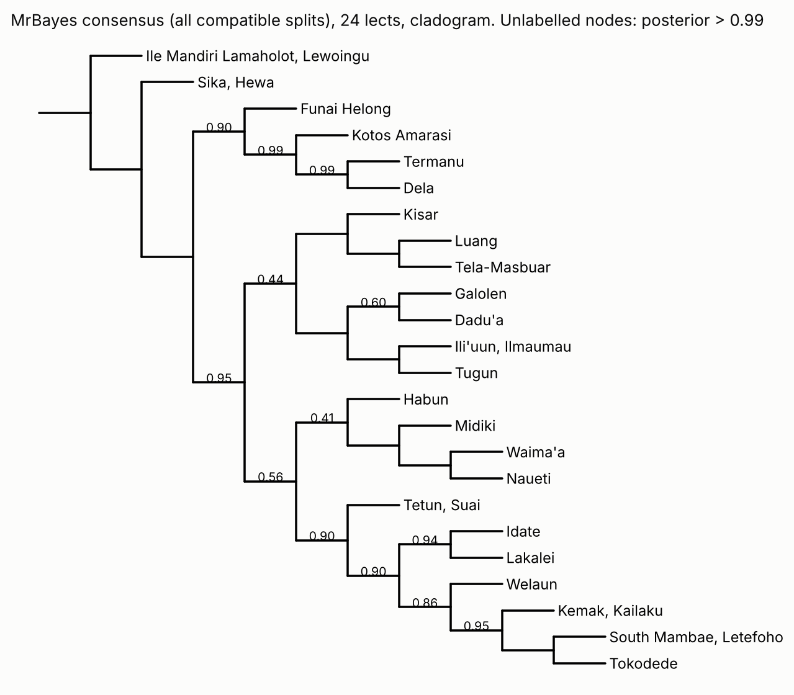
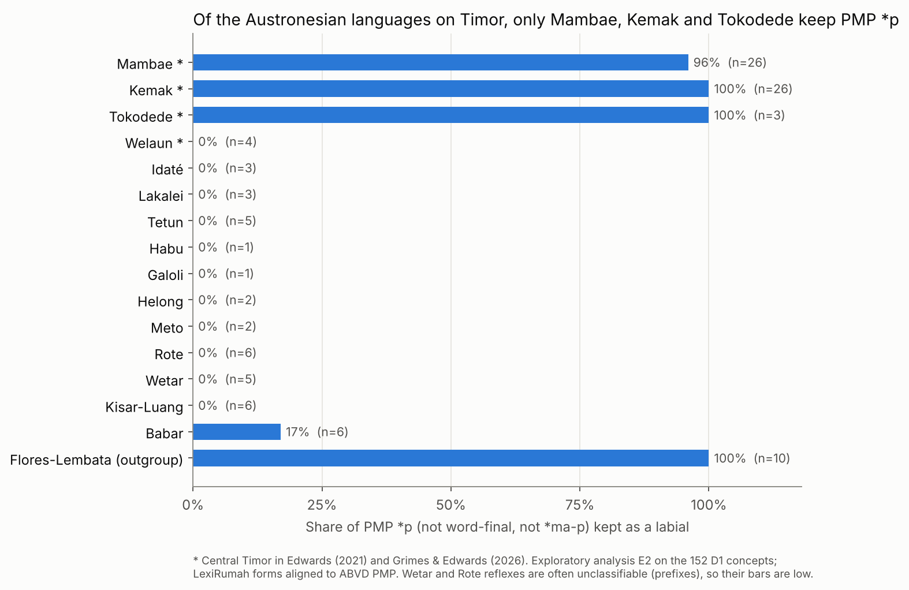
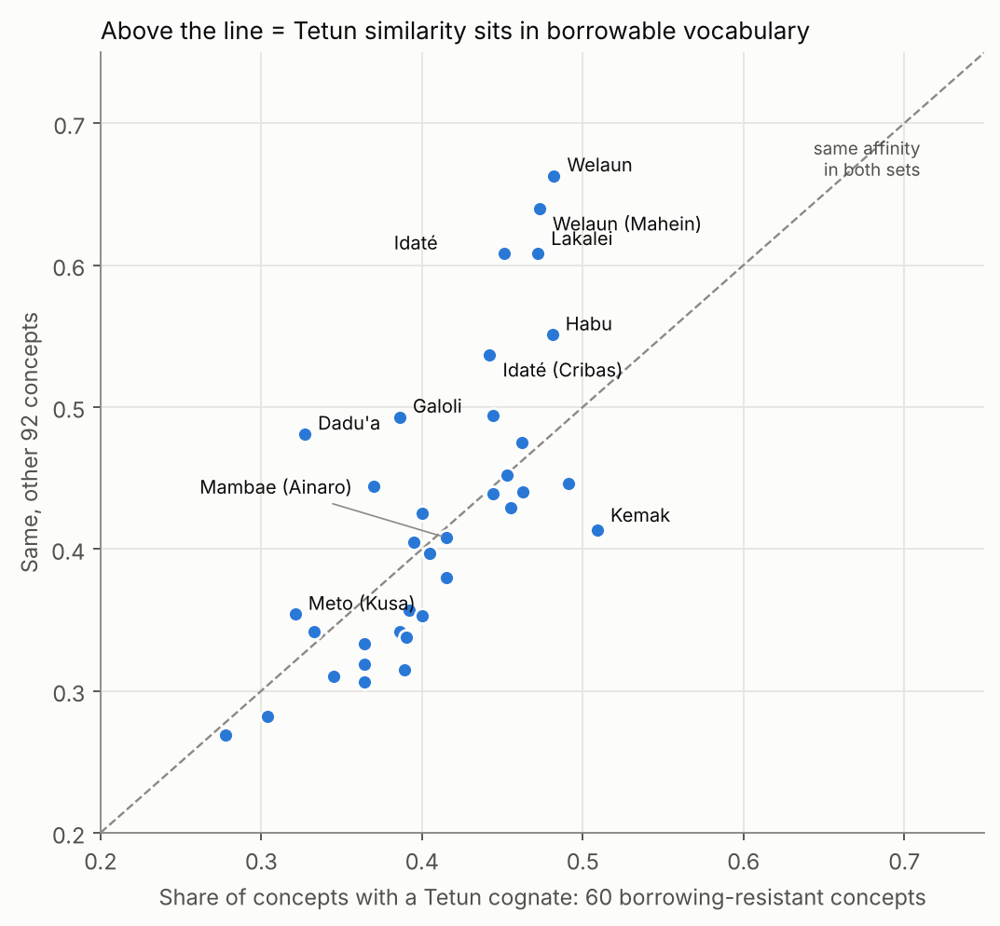

# Sanak: results

Run on 2026-10-10.

- **Protocol.** v1 was frozen at commit `35b913c`.
- **Addendum 1** is post hoc. It was adopted after the v1 gate failed.
- **Addendum 2** encodes Grimes and Edwards (2026) and the details for steps 5 to 7. It was pushed (`c1418a5`) before any hypothesis clade was scored.
- **Addendum 3** is post hoc. It adds E2b, E5 and E6 and was pushed (`cc06393`) before those were run.
- **Not blind.** The analyst had seen one full tree before Addendum 2, so steps 5 to 8 are pre-specified but not blind.
- **Labels.** Everything marked *exploratory* or *post hoc* sits outside the pre-registered decision.

## Answers

| Question | Pre-registered verdict (step 8) | What all the evidence says | Confidence |
|---|---|---|---|
| **Hull's Fabronic / Timoric A** | Not supported (0% in every analysis) | Rejected as a lexical group | High |
| **Timor-Babar** (Edwards; Grimes and Edwards) | Not supported (0%) | Not a lexical group: ln BF −7.0 against it, and forcing it costs 12 log-likelihood units in ML. It stands on its sound changes only. | High that the vocabulary doesn't show it |
| **Eastern Timor** (Edwards; Grimes and Edwards) | Not supported (0–3%) | Same as Timor-Babar | High |
| **C2. Is Welaun a Tetun dialect (Hull 1998) or Central Timor (Edwards)?** | Unresolved, because the bootstrap trees don't reach 70% for Central Timor | **Central Timor.** ln BF +10.3, the ML tree puts it there, and its Tetun tie disappears on borrowing-resistant words. This agrees with the sound changes in Edwards (2019) and Grimes and Edwards. | High |
| **C1. Do Idaté and Lakalei go with Mambae, Kemak and Tokodede (Hull's Ramelaic), or into Timor-Babar (Edwards)?** | Unresolved, because neither clade reaches 70% in the bootstrap trees | **Split.** The vocabulary puts Lakalei-Idate next to Central Timor, Welaun included: posterior 0.91, and ln BF +8.0 for Ramelaic. The sound changes favour Edwards: Lakalei-Idate lacks Central Timor's markers and shares Timor-Babar's *p > h. | Low: the two kinds of evidence disagree |
| **Low-level groups** | Supported (≥ 70% in every variant): Lakalei-Idate, Kawaimina, Wetar-Atauro, Wetar, Nuclear Rote, Kisar-Luang, Kisar-Roma, Babar, Peripheral Babar, South Babar | Settled. All of them are already in Grimes and Edwards and in Glottolog. | High |

## Gate (step 4)

- **Under v1 the gate failed** on G2: LexStat recovered 4 of 6 ABVD known-answer clades, below the 80% bar (`results/gate_v1.json`).
- **Under Addendum 1 it passes.**
  - G2 asks that LexStat does at least as well as the expert cognates. Both get 4 of 6, because two of the six checks fail with the expert cognates too.
  - G1: 14 of 15 LexiRumah known-answer clades.
  - G3: B-cubed F = 0.81 against the ABVD experts.
  - G4: Mantel r = 0.90 (p = 0.0001, 24 lects) between LexiRumah automatic distances and ABVD expert distances.

## Lexical clade tests (step 5)

Bootstrap support (1,000 concept resamples) on LexiRumah with LexStat cognates, shown as UPGMA / NJ. A clade counts as **supported** only if both trees reach 70% on the primary data, with contact sets removed, and with Tetun look-alikes removed. All 30 clades are in `results/hypotheses/summary_d1_lexstat.csv`; every configuration, including SCA, `biglexstat` and ABVD, is in `clade_support.csv`.

| Clade | Source | Primary | Tetun look-alikes removed | Austronesian only | Verdict |
|---|---|---|---|---|---|
| Ramelaic (Mambae, Kemak, Tokodede, Idaté, Lakalei) | Hull | 22 / 55 | 88 / 95 | 22 / 62 | no |
| Fabronic / Timoric A | Hull | 0 / 0 | 0 / 0 | 0 / 0 | no |
| Welaun inside Tetun | Hull 1998 | 51 / 59 | 19 / 16 | 51 / 60 | no |
| Central Timor (with Welaun) | Edwards; G&E | 14 / 17 | 32 / 18 | 14 / 19 | no |
| Nuclear Central Timor (no Welaun) | G&E | 37 / 75 | 27 / 28 | 37 / 78 | no |
| Timor-Babar | Edwards; G&E | 0 / 0 | 0 / 0 | 0 / 0 | no |
| Eastern Timor | Edwards; G&E | 1 / 1 | 3 / 2 | 1 / 1 | no |
| Eastern Timor + Lakalei-Idate | G&E (possible) | 0 / 0 | 0 / 0 | 0 / 0 | no |
| Lakalei-Idate | Edwards; G&E | 100 / 99 | 97 / 99 | 100 / 99 | **yes** |
| Kawaimina (Midiki, Waima'a, Naueti) | all | 100 / 100 | 100 / 100 | 100 / 100 | **yes** |
| Waima'a-Naueti | G&E | 64 / 64 | 68 / 62 | 64 / 64 | no |
| Wetar-Atauro | Edwards; G&E | 88 / 97 | 99 / 97 | 88 / 97 | **yes** |
| Wetar | G&E | 100 / 100 | 100 / 100 | 100 / 100 | **yes** |
| Nuclear Rote | G&E | 93 / 91 | 93 / 92 | 93 / 91 | **yes** |
| West Rote-Meto (Dela + Meto) | G&E | 0 / 0 | 0 / 0 | 0 / 0 | no |
| Southwest Maluku | Edwards; G&E | 0 / 30 | 1 / 52 | 0 / 100 | no |
| Kisar-Luang | G&E | 100 / 99 | 100 / 100 | 100 / 97 | **yes** |
| Babar | G&E | 100 / 100 | 100 / 100 | 100 / 100 | **yes** |

Values are percentages. The contact-set variant matches the primary within a few points everywhere, so it is left out of this table.

- **Hull's Ramelaic jumps to 88–95% once Tetun look-alikes are removed.** That variant can't be read as support. It deletes exactly the words Idaté and Lakalei share with Tetun, which is the evidence Edwards's placement would predict. The protocol flagged this inheritance confound in advance.
- **No grouping above the low-level clades passes.** The bootstrap trees don't sort Timor's vocabulary into the higher groups of either classification.

## Treelikeness (step 6)

| Set | Mean delta | Mean Q-residual |
|---|---|---|
| 37 Timor Austronesian lects (pre-registered) | 0.240 | 0.0072 |
| 64 Austronesian lects | 0.243 | 0.0037 |
| 24 lects, one per language | 0.334 | 0.0048 |

- **The pre-registered set passes the 0.3 bar**, so the tree results are not flagged as weak.
- **At one lect per language the signal is clearly reticulate** (0.33). The many Mambae and Kemak dialects pull the 37-lect figure down.
- **The most reticulate lects are the contested ones.** In order: Welaun (0.31), Tokodede, Welaun-Mahein, Galoli, Lakalei, Tetun Dili, Idaté (0.28) and Habu.
- **The NeighborNet** fits the distances at 99.9%. Idaté and Lakalei sit between Central Timor and Tetun–Habu, with box-like conflict on both sides.

## Bayesian constraint tests (step 7)

MrBayes 3.2.7a was run on 24 lects (one per language) and 1,353 binary cognate characters (LexiRumah, LexStat, primary data). Each clade was run twice: forced, and forbidden. Marginal likelihoods come from stepping-stone sampling (50 steps, 5 million generations, 2 runs each). The two runs agree within 0.8 log units in every analysis.

| Contrast | ln ML forced | ln ML forbidden | ln BF | Reading |
|---|---|---|---|---|
| **C1** Ramelaic (Mambae, Kemak, Tokodede, Idaté, Lakalei) | −8092.25 | −8100.27 | **+8.0** | strong for Ramelaic |
| **C2** Central Timor with Welaun | −8091.87 | −8102.12 | **+10.3** | strong for Central Timor |
| Timor-Babar (everything except Central Timor and the root) | −8107.39 | −8100.37 | **−7.0** | strong against Timor-Babar |

- **Forcing Ramelaic and forcing Central Timor fit about equally well** (−8092.25 vs −8091.87), even though both can't be clades at once. Forbidding either costs 8 to 10 log units.
- **The vocabulary wants a Central Timor core with both Welaun and Lakalei-Idate attached close to it.** The unconstrained run below confirms this.
- **The Timor-Babar result is largely the C1 signal seen from the other side.** Forcing Timor-Babar pulls Lakalei-Idate away from Central Timor.

Posterior probabilities from the unconstrained run (2 runs × 2 chains, 2 million generations, 25% burn-in):

| Clade | Posterior |
|---|---|
| Nuclear Central Timor (Mambae, Kemak, Tokodede) | 0.95 |
| Lakalei-Idate | 0.94 |
| Central Timor with Welaun + Lakalei-Idate | **0.91** |
| Southern Tetun + the clade above | 0.90 |
| Central Timor with Welaun | 0.86 |
| Hull's Ramelaic exactly (Lakalei-Idate + Nuclear Central Timor, no Welaun) | 0.13 |
| Kawaimina | 1.00 |
| Welaun + Tetun | 0.00 |
| Eastern Timor | 0.00 |
| Eastern Timor + Lakalei-Idate | 0.00 |
| Timor-Babar | 0.00 |

- **Convergence.** Split frequencies differ between runs by 0.005 on average, the minimum ESS is 1,074, and the PSRF is 1.001 or below.
- **Cross-check.** Posterior odds divided by prior odds give ln BF 10.3 for Central Timor and 8.2 for Ramelaic, matching the stepping-stone values (10.3 and 8.0).
- **The posterior favours a broader version of Hull's Ramelaic, with Welaun included.** The exact clade Hull drew gets only 0.13. Lakalei-Idate is the sister of Central Timor including Welaun (0.91).
- **Southern Tetun attaches to that group next (0.90)**, ahead of Habu and Kawaimina. In the vocabulary, Tetun sits with central Timor rather than with the Eastern Timor languages, likely another mark of its role as the lingua franca.

## Exploratory analyses (not part of the decision)

### E1. Borrowing-resistant vocabulary

The step 5 test was rerun on the 60 concepts from the Leipzig-Jakarta list (Tadmor 2009), which are the hardest to borrow, and separately on the other 92. Values are bootstrap UPGMA / NJ.

| Clade | Stable 60 | Other 92 |
|---|---|---|
| Welaun inside Tetun (Hull 1998) | 2 / 4 | 74 / 81 |
| Ramelaic (Hull) | 44 / 48 | 10 / 21 |
| Central Timor with Welaun (Edwards) | 34 / 39 | 2 / 3 |
| Nuclear Central Timor | 33 / 41 | 18 / 54 |
| Lakalei-Idate | 92 / 93 | 91 / 87 |

- **Welaun's tie to Tetun lives entirely in borrowable vocabulary.** On stable concepts it is gone.
- **On stable concepts the best tree has Central Timor (with Welaun) as a clade, with Lakalei-Idate as its sister.** That is Hull's Ramelaic plus Welaun, though support stays under 50%.

### E2. The defining sound changes, recomputed

Each LexiRumah form was aligned to its ABVD Proto-Malayo-Polynesian ancestor, and the reflexes of *p (not word-final, not *ma-p) and *ŋ were read off. This uses the 152 D1 concepts.

| Group | *p kept | *ŋ > velar stop |
|---|---|---|
| Mambae | 25 of 26 | 22% of 23 |
| Kemak | 26 of 26 | 29% of 14 |
| Tokodede | 3 of 3 | (no cases) |
| Welaun | 0 of 4 | 0 of 5 |
| Idaté | 0 of 3 | 0 of 11 |
| Lakalei | 0 of 3 | 0 of 3 |
| Tetun | 0 of 5 | 0 of 16 |
| Meto, Helong, Kisar-Luang, Galoli, Habu | 0 of 12 | 0 of 47 |
| Flores-Lembata (outgroup) | 10 of 10 | 0 of 18 |

- **Mambae, Kemak and Tokodede keep *p, and only they show *ŋ > g/k.** These are the two changes that define Central Timor and Timor-Babar in Grimes and Edwards (2026).
- **Idaté and Lakalei side with Timor-Babar on both.** Together they keep *p in 0 of 6 words, against 54 of 55 in Mambae, Kemak and Tokodede (Fisher's exact p = 1.3 × 10⁻⁷).
- **The *ŋ share for Mambae and Kemak is understated.** The automatic alignment misreads some forms: Mambae *pənɛga* 'hear' has *ŋ > g but was scored as nasal. The real velar share is higher.
- **Caveats.** The counts are small, and the analysis replicates the diagnostics rather than testing them independently.

### E2b (post hoc). The same words, checked by hand

Many of the Idaté and Lakalei words behind E2 are identical to Tetun, so they could be loans. Only the others count as native evidence (`results/exploratory/e2b_diagnostic_words.csv`).

| Etymon | Idaté / Lakalei | Mambae, Kemak, Tokodede | Tetun | What it shows |
|---|---|---|---|---|
| *taliŋa 'ear' | Idaté *talina* | *teliga*, *ligar*, *təligirɔa* | *tilun* | native *ŋ > n; no Central Timor *ŋ > g |
| *əpat 'four' | *ʔaːt*, *aːt* | *faːt*, *paːt*, *paːt* | *haːt* | *p lost, in a shape unlike Tetun |
| *nipən 'tooth' | Lakalei *niɑn* | *nifa*, *nipar*, *nipa* | *nɛhɑn* | *p lost |
| *palu 'hit' | Idaté *paʔu*, Lakalei *baʔu* | (other words) | *baku* | a labial kept: the one counter-case |
| *ŋajan 'name', *naŋuy 'swim', *manipis 'thin' | *naran*, *nani*, *mihis* | *kala*/*gala*, *nagi*, (other) | *naran*, *nani*, *mihis* | identical to Tetun, so possibly loans |

- **Grimes and Edwards add more native cases.** They cite *pija > *ila*/*yila* 'how much' and *hapuy > *wai* 'fire' (both *p lost, both unlike Tetun). They also give *ma-p > b (*butin* 'white', *banas* 'hot'), where Central Timor has *mp.
- **The catch is in their Central Timor chapter.** Welaun, a Central Timor language, also has initial *p > h in native words (*hoat* 'four', *honu* 'full'). So *p > h happened more than once on Timor and could spread by contact.
- **What survives as the cleanest marker** is that Lakalei-Idate lacks Central Timor's *ŋ > g and *ma-p > mp in native words. That fits Edwards. It also fits a Ramelaic tree in which Lakalei-Idate split off before those changes.

### E3. Where the Tetun similarity sits

For each Timor lect, the share of concepts with a Tetun cognate was measured separately on stable and on other vocabulary.

- **Among the Austronesian lects, the largest gaps are in Welaun (+18 points), Welaun-Mahein (+17), Idaté (+16), Dadu'a (+15) and Lakalei (+14).** Their Tetun similarity is concentrated in borrowable words, the signature of contact. The Papuan Bunak lects show the same pattern (+18 to +20).
- **Kemak and Mambae show no gap.**
- **Post hoc (E3b): nearest groups by mean distance.**
  - On stable vocabulary, Lakalei-Idate is nearest Tokodede (0.48) and Mambae (0.50), and Welaun is nearest Mambae (0.48) and Kemak (0.49).
  - On borrowable vocabulary, both are nearest Tetun (0.45 and 0.40).

### E4 (post hoc). Retention or innovation?

The question is whether Lakalei-Idate's cognate sets shared with Central Timor are also found outside central Timor. If they are, they are shared retentions or wider regional words, which say nothing about subgrouping.

| Lakalei-Idate shares a set with… | Sets | Also found outside central Timor | Exclusive |
|---|---|---|---|
| Central Timor, not Tetun | 56 | 35 | **21** (6 stable, 15 other) |
| Tetun, not Central Timor | 18 | 9 | **9** (2 stable, 7 other) |

- **Lakalei-Idate has more than twice as many exclusive links with Central Timor as with Tetun.** On Hull's view these are shared lexical innovations; on Edwards's view they are old loans from Central Timor neighbours.

### E5 (post hoc). Does geography explain it?

- **The fit.** Across the 666 pairs of Timor Austronesian lects, lexical distance rises with log geographic distance (r = 0.71).
- **The residuals.** Relative to that trend, measured in standard deviations (negative = more similar than distance predicts):

| Pair | Mean km | Residual |
|---|---|---|
| Lakalei-Idate → Kemak | 100 | **−0.75** |
| Lakalei-Idate → Welaun | 100 | −0.68 |
| Lakalei-Idate → Tetun | 70 | −0.48 |
| Lakalei-Idate → Tokodede | 80 | +0.06 |
| Lakalei-Idate → Mambae | 45 | +0.40 |
| Lakalei-Idate → Kawaimina | 62 | +1.11 |
| Lakalei-Idate → Galoli | 24 | +1.37 |
| Lakalei-Idate → Habu | 16 | **+1.55** |
| Welaun → Kemak | 15 | +1.34 |
| Welaun → Tetun | 60 | −0.51 |

- **Lakalei-Idate is unusually close to Kemak, 100 km away.** It is unusually far from its eastern neighbours Habu and Galoli, 16 to 24 km away. Simple proximity can't explain its Central Timor tie, and the vocabulary gives no hint of the Eastern Timor link Grimes and Edwards consider possible.
- **Welaun is less like neighbouring Kemak, and more like Tetun, than distance predicts.** That fits heavy Tetun contact.

### E6 (post hoc). Maximum-likelihood cross-check

IQ-TREE 2.3.6, GTR2+FO+G4, on the same 24-lect matrix as step 7.

- **The ML tree.**
  - Lakalei-Idate sits with Central Timor including Welaun (ultrafast bootstrap 52).
  - Welaun is inside Central Timor (59).
  - Mambae, Kemak and Tokodede form a strong core (97).
- **The constraint tests.**

| Tree | ΔlogL | AU p |
|---|---|---|
| Best (unconstrained) | 0 | 0.61 |
| Ramelaic forced (no Welaun) | 1.1 | 0.47 |
| Lakalei-Idate + Eastern Timor forced | 10.4 | 0.071 |
| Timor-Babar forced | 11.7 | 0.067 |

- Forcing Central Timor, with or without Lakalei-Idate, returns the best tree itself.
- The AU test does not reject Timor-Babar or Lakalei-Idate + Eastern Timor at 0.05, but both sit at the edge.
- Addendum 3 listed "Nuclear Central Timor plus Lakalei-Idate" as a constraint. That is identical to Ramelaic, so it was replaced by "Central Timor with Welaun plus Lakalei-Idate".

## Interpretation (analyst's reading, A3.5)

**Settled.**

- Hull's Fabronic is not a lexical group.
- Neither are Timor-Babar or Eastern Timor.
- The low-level groups in the Answers table are real.
- **Welaun is a Central Timor language with a thick Tetun overlay.** Every lexical method that controls for borrowing puts it in Central Timor (ln BF +10.3, ML, stable vocabulary). Its Tetun-like look comes from borrowable words. This matches Edwards (2019) and Grimes and Edwards (2026).

**C1, Lakalei-Idate, is not settled by these data, and the reason is specific.** Two kinds of evidence point in different directions.

- **The vocabulary points to Central Timor.**
  - The Bayesian test gives ln BF +8.0 for Ramelaic and posterior 0.91 for Lakalei-Idate as sister to Central Timor, Welaun included. The ML tree agrees.
  - On stable words Lakalei-Idate is nearest Tokodede and Mambae.
  - It has 21 exclusive cognate links with Central Timor against 9 with Tetun.
  - It is closer to Kemak than a 100 km gap predicts.
  - These links run to Central Timor rather than to Tetun, so Tetun contact can't explain them.
- **The sound changes point to Timor-Babar.** In native words Lakalei-Idate has *p > h/∅, *ŋ > n and *ma-p > b, and lacks Central Timor's *ŋ > g and *ma-p > mp.
- **Each side has a known weakness.**
  - Vocabulary can be borrowed between neighbours over centuries. Lakalei is 10 km from the nearest Mambae variety, and Idaté 24 km.
  - *p > h demonstrably also arose in Welaun, so it is not a clean diagnostic.
  - A missing *ŋ > g is compatible with Lakalei-Idate splitting off before that change.
- **On the comparative method's own standard**, which ranks shared sound changes over shared vocabulary, Grimes and Edwards's placement stands. No sound change unites Lakalei-Idate with Central Timor alone. The honest summary is that Lakalei-Idate is an old, separate branch whose phonology follows Timor-Babar and whose basic vocabulary follows Central Timor.
- **Two histories fit this**, and these data cannot tell them apart:
  - a Timor-Babar language with a deep Central Timor lexical layer;
  - a near-Central Timor branch that picked up Timor-Babar sound changes by contact.

## Novelty check (post hoc, 10 October 2026)

What Sanak adds was checked against the literature and against the one earlier Bayesian tree that covers Timor, Gray, Drummond and Greenhill (2009). Their 998 posterior trees were re-scored for the Timor clades (`src/17_gray2009.py`). They use ABVD expert cognates and include Tetum, Mambai, Kemak, Galoli, Atoni, Roti, Wetar, Southwest Maluku and Babar. They have no Idaté, Lakalei, Welaun, Habu, Kawaimina, Tokodede, Dadu'a or Helong.

| Clade | Gray et al. 2009 posterior | Sanak |
|---|---|---|
| Mambai + Kemak (Central Timor core) | 1.00 | 0.95 (with Tokodede) |
| Tetum + Mambai + Kemak | 0.71 | 0.90 (Tetun + Central Timor + Lakalei-Idate) |
| Timor-Babar | 0.00 | 0.00; ln BF −7.0 |
| Southwest Maluku | 0.00 | not supported |
| Hull's Fabronic | 0.00 | 0% in every analysis |
| Wetar-Atauro | 1.00 | 88–97% bootstrap |
| Rote-Meto; Babar; Wetar | 1.00 | supported |

**New, as far as could be found.**

- **Language coverage.** This is the first computational placement of Idaté, Lakalei, Welaun, Habu, Midiki and Helong, none of which is in ABVD. (Tokodede, Dadu'a, Naueti and Waima'a joined ABVD after 2009.) Kaiping and Klamer (2022) used LexiRumah and LexStat the same way, but only for the Papuan (Timor-Alor-Pantar) languages.
- **The comparison itself.** This is the first explicit test of Hull's Ramelaic against Edwards and Grimes and Edwards. Grimes and Edwards (2026) do not cite Hull and make no lexical or computational argument for Timor.
- **Lakalei-Idate.**
  - Its vocabulary sits with Central Timor: posterior 0.91, and ln BF +8.0 for Ramelaic.
  - Geography doesn't explain this (E5).
  - The tie conflicts with its sound changes. This revives Hull's lexical grouping with modern methods and sets it against Grimes and Edwards's phonology.
- **Welaun.** It falls in Central Timor by lexical phylogenetics once borrowing is controlled (ln BF +10.3). That is a new, independent line of support for Edwards (2019).
- **Contact profiles.** Tetun affinity is concentrated in borrowable words for Welaun (+18 points), Idaté (+16) and Lakalei (+14), and not for Kemak or Mambae.
- **Validation.** LexStat on Timor scores B-cubed F 0.81 against the experts. That is below the roughly 0.89 average List, Greenhill and Gray (2017) report across families. LexiRumah's automatic distances match ABVD's expert distances at r = 0.90.

**Confirmations rather than discoveries.**

- **Patterns latent in 2009.** The lexical absence of Timor-Babar, Southwest Maluku and Fabronic, and Tetun's pull towards Central Timor, are all present in Gray et al.'s 2009 posterior. As far as could be found, nobody wrote them up for Timor. Sanak replicates them on an independent dataset.
- **Already established.**
  - Welaun's Tetun-like vocabulary as contact: Edwards 2019, with 55–58% similarity.
  - The *p and *ŋ diagnostics: Grimes and Edwards 2026.
  - The low-level groups.
  - Bunak's heavy Austronesian borrowing: about 30% Malayo-Polynesian vocabulary (Schapper 2011, cited in Klamer 2023).
  - LexiRumah's automatic cognates: stated in its own README.

**Limits of the check.**

- **Not reachable.** Paywalled journals and theses could not be searched exhaustively. Hull (1998) could not be read in full, so his percentages are not compared. Two pages failed to load: the LexiRumah PLOS ONE paper (rate-limited) and Greenhill et al. (2010) on PubMed Central (bot check).
- **Wording.** "New" therefore means "not found", not "proven absent".

## What would settle C1

1. **More words with *p and *ŋ for Idaté and Lakalei.** The LexiRumah lists give only a handful of native cases. Grimes and Edwards's 494-item lists, collected for both languages, would show whether the native cases are regular.
2. **Innovation-based phylogenetics.** Code the sound changes in Grimes and Edwards §4.8 and §5.5 as binary characters, add them to the 1,353 lexical characters, and rerun step 7. If the sound changes are coherent, they should outweigh a diffuse lexical signal.
3. **A borrowing-aware model.** Fit a model that lets a Central Timor or Tetun lexical layer be its own component, and ask whether Lakalei-Idate's Central Timor links look like a layer or like descent.

## Caveats

- **Shared sources.** LexiRumah and Grimes and Edwards share sources and an editor (Edwards). The lexical data are not independent of the classification being tested.
- **Splitting bias.** Automatic cognates split more than experts do (precision 0.88, recall 0.75). That lowers similarity between distant lects more than between close ones.
- **Reticulation.** The Bayesian and ML tests use 24 lects and lexical characters only, so they inherit the lexicon's reticulation (delta 0.33 at this level).
- **Small native samples.** The sound-change counts for Idaté and Lakalei are small.
